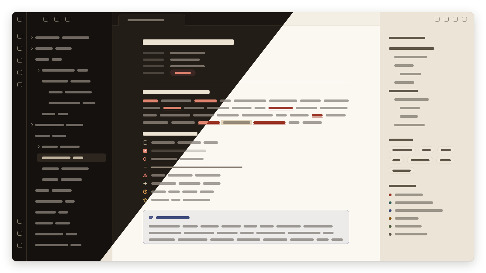

# Saga

An Obsidian theme in the Saga app's modern parchment style: parchment and ink for the light scheme, leather and ink for the dark. It sets Obsidian's CSS variables from Saga's tokens and adds selector rules only where variables cannot reach. It works well with the Saga plugin or standalone.

## Colours

`theme.css` declares Saga's token names (`--saga-ground`, `--saga-sheet`, `--saga-ink`, `--saga-rubric`, ...) under `.theme-light` and `.theme-dark`; every Obsidian variable references them.

| Role | Light | Dark | Obsidian variable |
| --- | --- | --- | --- |
| Sheet (note) | `#fbf8f2` | `#231d17` | `--background-primary` |
| Ground (tab bar, status bar) | `#f4efe5` | `#1b1612` | `--background-secondary` |
| Chrome (sidebars) | `#ece5d7` | `#15110e` | `--background-secondary-alt` |
| Chip (code, tags, table headers) | `#eee7da` | `#2d261e` | `--code-background`, `--tag-background` |
| Rule | `#ddd3c2` | `#3a3126` | `--background-modifier-border` |
| Ink | `#2a241d` | `#ece3d2` | `--text-normal` |
| Ink 2 | `#5f5547` | `#bfb39e` | `--text-muted` |
| Ink 3 | `#6b5f51` | `#a99d88` | `--text-faint` |
| Rubric (links, accent text) | `#9a3324` | `#e0846f` | `--text-accent`, `--link-color` |
| Accent fill (buttons, checked boxes) | `#9a3324` | `#b5503d` | `--interactive-accent`, `--accent-h/s/l` |
| Gilt (quote bar, highlight) | `#b08d4c` | `#c9a55e` | `--blockquote-border-color` |
| Red | `#a8321f` | `#e0786a` | `--color-red` |
| Ochre | `#8f5412` | `#d89a52` | `--color-orange` |
| Yellow | `#b08d4c` | `#c9a55e` | `--color-yellow` |
| Green | `#336d52` | `#7bbf9b` | `--color-green` |
| Teal | `#2f5f5a` | `#6fb3a9` | `--color-cyan` |
| Blue | `#3d4a7c` | `#9aa6dc` | `--color-blue` |
| Purple | `#6b3a62` | `#c58bb9` | `--color-purple` |
| Pink | `#a1506a` | `#dc92a8` | `--color-pink` |

The Saga plugin's renderer colours (`--saga-character`, `--saga-location`, `--saga-faction`, `--saga-item`, `--saga-map`, `--saga-document` and their `-tint`) are set for both schemes with `body.theme-*.theme-*` selectors, which outrank the plugin's own defaults regardless of load order.

Body ink, muted and faint text, rubric links and the accent fill's white text meet WCAG AA (4.5:1) on the sheet, ground, chrome and chip surfaces in both schemes. Gilt is decorative only.

## Type

- Headings and the inline title: Fraunces (600), sizes 1.9, 1.5, 1.25, 1.05em; inline title 46px, tracking -0.015em; h6 in small caps
- Reading text: Source Serif 4, line height 1.65
- Interface: IBM Plex Sans; code: IBM Plex Mono
- Property keys and the Properties heading: 11px, 600, uppercase, 0.1em tracking

The fonts are embedded in `theme.css`.

## Callouts

Saga's own callout types, with the Saga app's icons:

| Syntax | Colour |
| --- | --- |
| `> [!secret]` | Red |
| `> [!statblock]` | Ochre |
| `> [!read-aloud]` | Blue |

## Checkboxes

Every marker in the [Alternative Checkboxes Reference Set](https://github.com/damiankorcz/Alternative-Checkboxes-Reference-Set) draws as its Lucide icon in a Saga hue, in Reading view and Live Preview:

| Syntax | Name | Colour | Syntax | Name | Colour |
| --- | --- | --- | --- | --- | --- |
| `[ ]` | Not started | Ink 3 | `[l]` | Location | Teal |
| `[x]` | Done (filled) | Accent fill | `[b]` | Bookmark | Rubric |
| `[/]` | Doing | Rubric | `[i]` | Information | Blue |
| `[-]` | Cancelled | Ink 3 | `[S]` | Savings | Green |
| `[>]` | Forwarded | Ink 2 | `[I]` | Idea | Yellow |
| `[<]` | Scheduling | Ink 2 | `[p]` | Pros | Green |
| `[?]` | Question | Ochre | `[c]` | Cons | Red |
| `[!]` | Important | Red | `[f]` | Fire | Red |
| `[*]` | Star | Yellow | `[k]` | Key | Ochre |
| `["]` | Quote | Ink 2 | `[w]` | Win | Yellow |
| `[u]` | Up | Green | `[d]` | Down | Red |

`[-]` lines are struck through. A snippet setting `--theme-alternative-checkboxes: disable` on `body` turns the alternative markers off.

## Markdown

- Links: rubric, underlined; unresolved links in ink 3 with a dashed underline.
- Inline code: chip background with a rule ring, ink 2 text.
- Highlights: gilt at 38%.
- Tags: ink 2 pills on chip with a rule ring.
- Quotes: italic ink 2 beside a 3px gilt bar.
- Tables: chip header row in the interface font, rule borders.
- Bullets by level: bullet, hollow bullet, square, diamond, repeating (levels 1 to 8).

## Install

With [BRAT](https://github.com/TfTHacker/obsidian42-brat): Add beta theme, `lobrenov/saga-theme`. Or copy `manifest.json` and `theme.css` into `<vault>/.obsidian/themes/Saga/`, then choose Saga in Settings → Appearance → Themes.

## Files

- `src/theme.css` hand-written source
- `build.mjs` (`npm run build`) writes `theme.css`: `@font-face` rules with the woff2 files as base64 data URIs, then the source. The built `theme.css` is committed.
- `fonts/` vendored woff2 files and their SIL OFL notices (`LICENSE-*.txt`)
- `assets/` README preview (`preview.png`) and the 512×288 community theme screenshot (`screenshot.png`)
- `manifest.json`
- `versions.json` each theme version's minimum Obsidian version
- `.github/workflows/release.yml` on a pushed tag, creates a draft GitHub release with `manifest.json` and `theme.css` attached

## Release

Bump `version` in `manifest.json` and `package.json`, add it to `versions.json`, build, commit, then push a tag named the version (`git tag 0.1.2 && git push origin 0.1.2`). Publish the draft release the workflow creates.

## Licence

Fonts: SIL Open Font License (`fonts/LICENSE-*.txt`).
